# Pipeline de conversaciones en Azure

Pipeline de ingesta diaria en Azure: se creó un contenedor que genera data faker sobre conversaciones de atención al cliente de un sistema origen (un software simulado, se asume que existiera), las deja como **CSV** en un **Data Lake** en la capa raw y **Data Factory** las convierte automáticamente a **Parquet**. Se usa (**Bicep**) para definir toda la infraestructura, se despliega con **GitHub Actions** y ningún componente usa contraseñas: los accesos se resuelven con **Managed Identity** y **RBAC**.

- Además se creó la suscripción usando un budget alert.
- Usaré key vault para no manejar contraseñas de manera pública.
- Para no esperar que se ejecute una vez por dia, bueno se puede correr manualmente el script con fecha de input en el generador de conversaciones, ver readme de extractor.
- El proyecto estará en la nube durante 1 sem y después eliminaré la suscripción.
- Con data factory se trato de simular una conversión a parquet como parte de una normalización de rutina que tendría un software de chats conversacionales masivo para reducir espacio, formatear, etc. para que se consuma por otro pipeline. En mi experiencia ahí ya entraría hacer arquitectura medallion, masomenos lo que implementamos aquí : raw y staging. Me resultó interesante ya que intente asi implementar en azure y descargar los bicep, pero generaba mucho código, y recorde una sesión que nos recomendaron no hacerlo. 
> Proyecto final del bootcamp de Azure (UTP). El sistema origen se simula con datos ficticios.

## Arquitectura

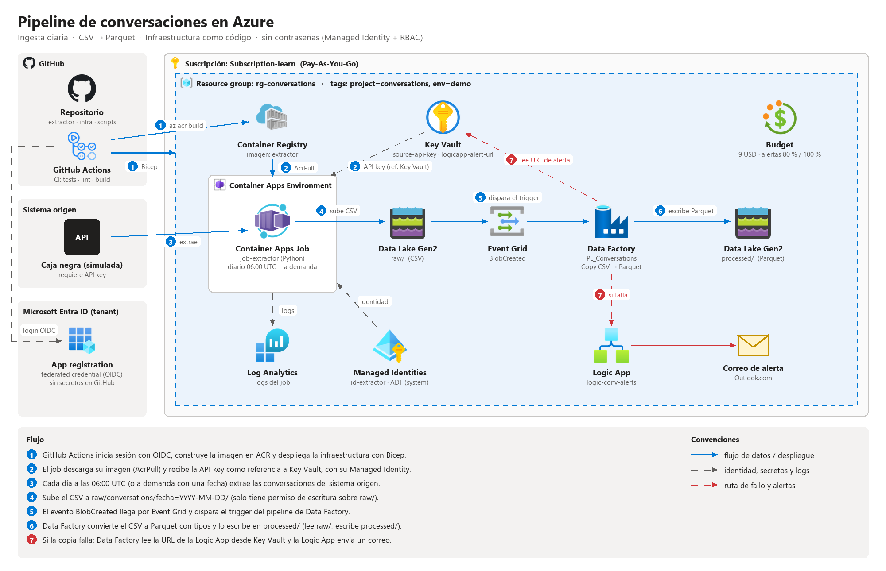

**Flujo:** el job se ejecuta cada día (o a demanda con una fecha) → obtiene la API key desde Key Vault → extrae las conversaciones → sube `raw/conversations/fecha=YYYY-MM-DD/conversations_YYYY-MM-DD.csv` → un *Storage Event Trigger* lanza el pipeline de Data Factory → escribe el Parquet con tipos en `processed/`. Si la conversión falla, Data Factory lee la URL de la Logic App desde Key Vault y envía un correo de alerta.

## El pipeline en acción

### 1. Despliegue

Toda la infraestructura se crea con Bicep desde GitHub Actions (login por OIDC, sin contraseñas).

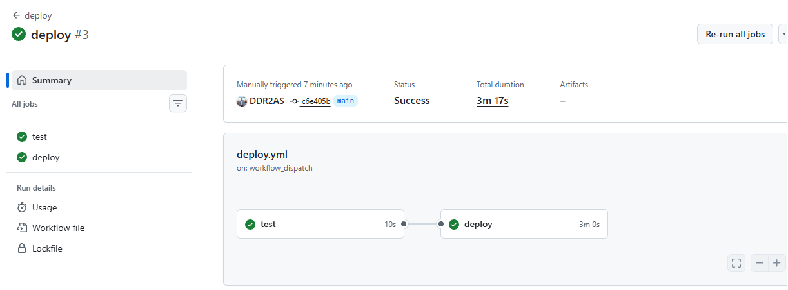

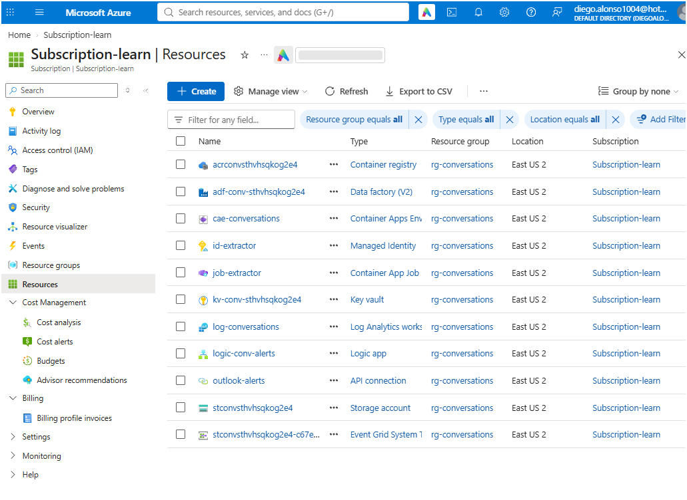

### 2. Extracción (Container Apps Job)

El job se lanza para una fecha y Azure levanta el contenedor, ejecuta el extractor y lo apaga.

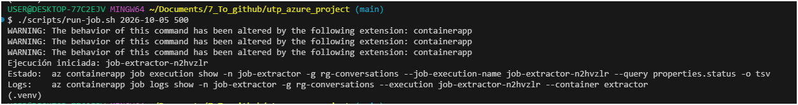

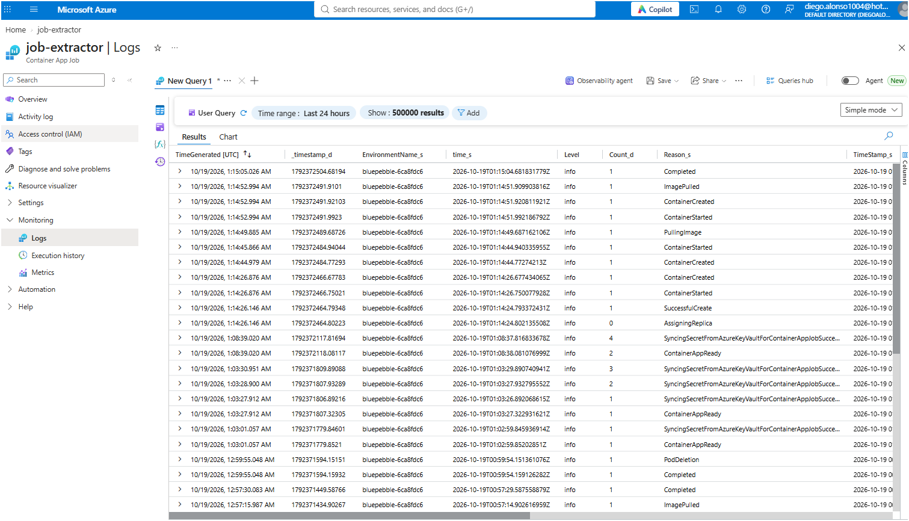

### 3. Capa raw (CSV)

El CSV queda particionado por fecha: `raw/conversations/fecha=YYYY-MM-DD/`.

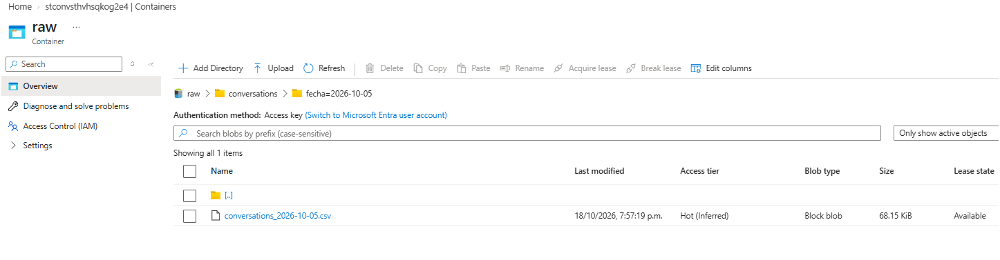

### 4. Data Factory (CSV → Parquet)

El evento *BlobCreated* dispara el pipeline `PL_Conversations`.

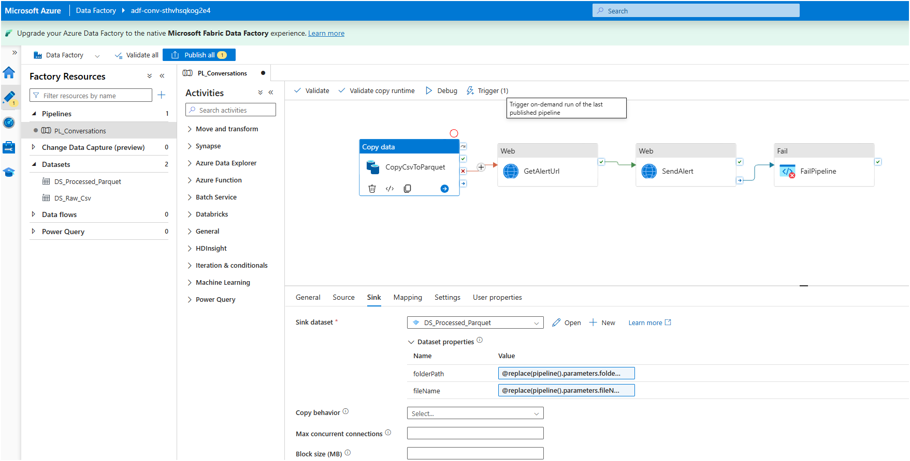

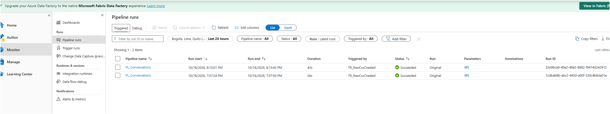

### 5. Capa processed (Parquet)

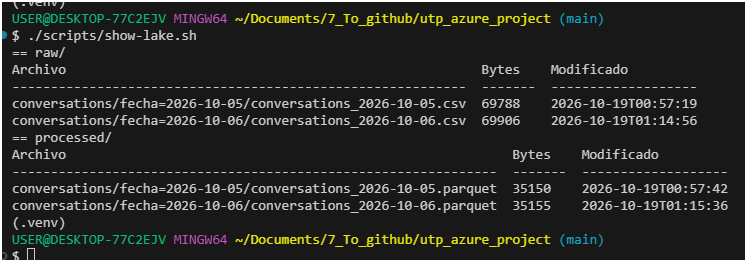

### 6. Seguridad y costos

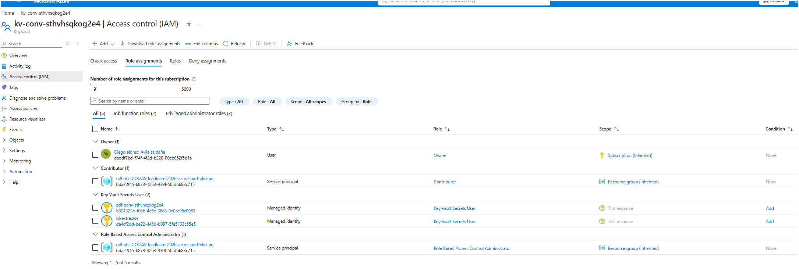

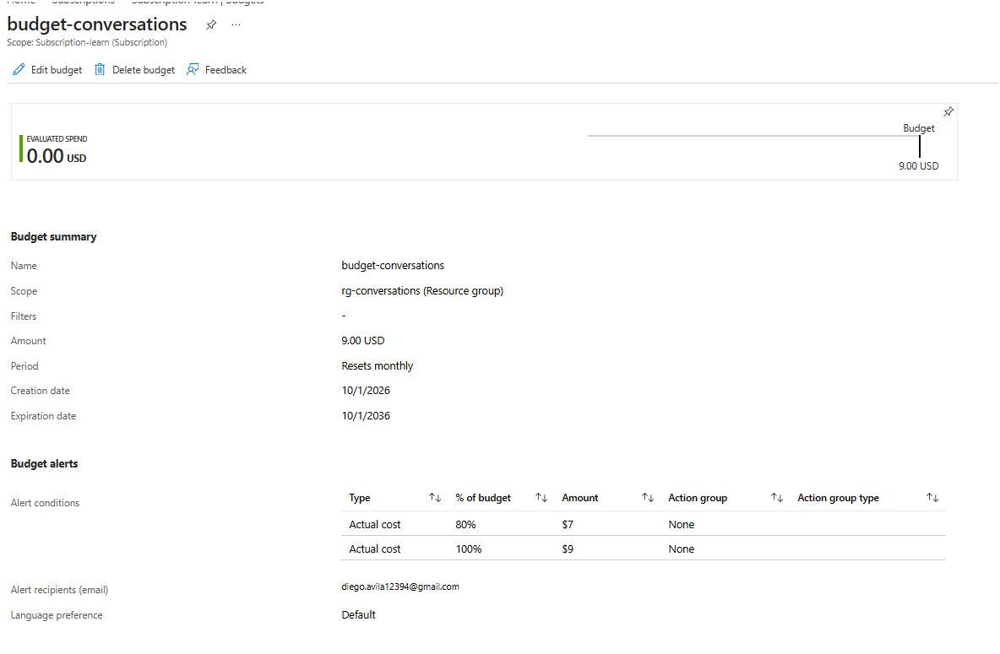

## Servicios

| Servicio | Uso |
|----------|-----|
| Azure Container Registry | Imagen del extractor (construida con `az acr build`) |
| Azure Container Apps Jobs | Ejecución programada y a demanda del extractor |
| Azure Data Lake Storage Gen2 | Capas `raw` (CSV) y `processed` (Parquet) |
| Azure Data Factory | Conversión CSV → Parquet disparada por eventos |
| Azure Key Vault | API key del origen y URL de alertas |
| Azure Logic Apps | Correo cuando falla el pipeline |
| Log Analytics | Logs del job |
| Microsoft Entra ID + RBAC | Managed Identities, OIDC para GitHub, mínimo privilegio |
| Cost Management | Budget mensual con alertas |
| Bicep + GitHub Actions | Infraestructura como código y CI/CD |

## Estructura

```
├── conversation-generator-bb/ Contenedor Python (sistema origen simulado + subida al Data Lake)
├── infra/
│   ├── main.bicep          Punto de entrada
│   ├── secret.bicep        API key inicial del origen
│   └── modules/            storage · keyvault · registry · containerapps · datafactory · logicapp · roles · budget
├── scripts/                deploy · run-job · show-lake · cleanup · setup-github-oidc
├── .github/workflows/      ci.yml (PR) · deploy.yml (push a main)
├── resources/              Diagrama de arquitectura y capturas (screenshots/)
└── bicepconfig.json        Reglas del linter
```

## Probar rápido - Generador de conversaciones random

### En local

```bash
python -m venv .venv
source .venv/Scripts/activate        # Windows (Git Bash) · en PowerShell: .\.venv\Scripts\Activate.ps1
pip install -r conversation-generator-bb/requirements.txt

cd conversation-generator-bb
export SOURCE_API_KEY=mi-clave-de-prueba-123      # PowerShell: $env:SOURCE_API_KEY = "mi-clave-de-prueba-123"
python -m extractor --date 2026-10-05 --count 10 --output local --local-dir ../output
```

Resultado: `output/raw/conversations/fecha=2026-10-05/conversations_2026-10-05.csv`

### En Azure

```bash
./scripts/run-job.sh 2026-10-05 500      # lanza el job para esa fecha
./scripts/show-lake.sh                   # en 1–2 min: CSV en raw/ y Parquet en processed/
```


## Despliegue

Para ejecutar este proyecto se requiere:

- Una suscripción de Azure con rol **Owner** (el Bicep crea asignaciones de roles).
- **Azure CLI** con Bicep y la extensión `containerapp` (`az extension add --name containerapp`).
- **Git Bash** en Windows para los scripts `.sh`.
- No hace falta Docker local: la imagen se construye en ACR con `az acr build`.

### 1. Registrar los proveedores (una vez por suscripción)

```bash
for p in Microsoft.App Microsoft.ContainerRegistry Microsoft.OperationalInsights Microsoft.Storage \
         Microsoft.KeyVault Microsoft.DataFactory Microsoft.Logic Microsoft.EventGrid \
         Microsoft.Web Microsoft.ManagedIdentity Microsoft.Consumption; do
  az provider register --namespace "$p"
done
```

### 2. Desplegar

```bash
az login
ALERT_EMAIL=tu@correo.com ./scripts/deploy.sh
```

El script crea el resource group, la infraestructura base, la API key en Key Vault, construye la imagen en ACR, crea el job y activa el trigger de Data Factory. Es idempotente.

### 3. Autorizar el correo de alertas (una vez)

Portal → resource group → **API connection `outlook-alerts`** → *Edit API connection* → **Authorize** → *Save*.

### 4. Simular un día de conversaciones

```bash
./scripts/run-job.sh 2026-10-01 500
./scripts/show-lake.sh      # tras ~1-2 min aparecen el CSV en raw/ y el Parquet en processed/
```

La misma fecha siempre genera los mismos datos y sobrescribe sus archivos: repetir una ejecución no duplica información.

### 5. CI/CD con GitHub Actions (opcional)

```bash
./scripts/setup-github-oidc.sh <usuario>/<repo>
```

Crea una app registration con *federated credentials* para la rama `main` (sin secretos; registra el subject con y sin los IDs numéricos que GitHub puede enviar) y le asigna **Contributor** y **Role Based Access Control Administrator** solo sobre el resource group. Copia los valores que imprime en *Settings → Secrets and variables → Actions → Variables*.

| Workflow | Cuándo | Qué hace |
|----------|--------|----------|
| `ci.yml` | Pull request | Tests, lint de Bicep, build de la imagen |
| `deploy.yml` | Push a `main` | Tests y `scripts/deploy.sh` |

### 6. Borrar todo

```bash
./scripts/cleanup.sh
```

Borra el resource group y purga el Key Vault (soft delete) para poder volver a desplegar con el mismo nombre.

## Seguridad

| Identidad | Recurso | Rol |
|-----------|---------|-----|
| Job (user-assigned) | ACR | AcrPull |
| Job | Key Vault | Key Vault Secrets User |
| Job | Contenedor `raw` | Storage Blob Data Contributor |
| Data Factory (system-assigned) | Contenedor `raw` | Storage Blob Data Reader |
| Data Factory | Contenedor `processed` | Storage Blob Data Contributor |
| Data Factory | Key Vault | Key Vault Secrets User |
| GitHub Actions (OIDC) | Resource group | Contributor + RBAC Administrator |

- Los roles de datos están acotados a cada **contenedor**, no a toda la cuenta.
- La API key se inyecta en el job como **referencia a Key Vault**: el valor nunca aparece en la plantilla ni en el código.
- Las actividades de Data Factory que manejan la URL de alertas usan `secureInput`/`secureOutput` para que no quede en los logs.
- ACR sin usuario admin, Storage sin acceso público y TLS 1.2 mínimo.

Un **budget** de 9 USD avisa por correo al 80 % y al 100 %. Para minimizar costos: desplegar, probar y ejecutar `cleanup.sh`; Bicep permite recrear todo en minutos.
